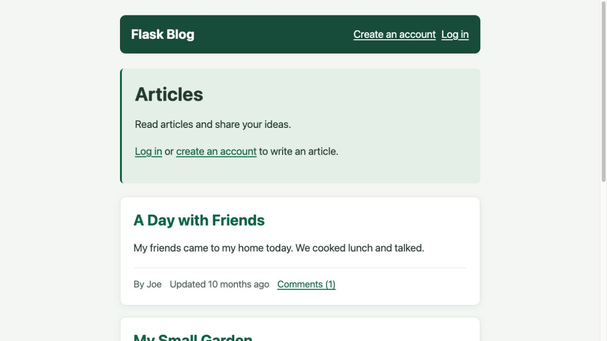

# Build a Flask Blog

**Start with two articles. Build toward a blog with accounts, publishing, and comments.**

Learn Flask through a project you can run and understand a few files at a time.
This starter contains the application at the end of Chapter 7: article pages,
shared Jinja templates, and a stylesheet.



*The finished hosted demo, captured November 4, 2026. Accounts and comments shown
here belong to the target app; they are not included in this starter.*

[Try the finished demo](https://flask-blog.justcodeit.net/)

## Run the starter

Use Python 3.10 or newer. From the folder containing `app.py`:

```sh
python3 -m venv .venv
source .venv/bin/activate
python -m pip install -r requirements.lock
python -m flask --app app run --host 127.0.0.1 --port 5000
```

On Windows, activate with `.venv\Scripts\activate` in Command Prompt or
`.venv\Scripts\Activate.ps1` in PowerShell. Use `python` instead of `python3`
if that is your Python command.

Open **http://localhost:5000**. Choose an article and follow its link back to the
list. No database, account, API key, or external service is needed. The commands
were checked with Python 3.14.5 on macOS arm64; Windows commands are provided but
have not been tested on Windows. The Flask server is for local learning.

## What is included

| This Chapter 7 starter | Finished target app |
| --- | --- |
| Two sample articles stored in Python | Articles, users, and comments in a database |
| Article list and detail pages | Create, edit, and delete articles |
| Shared Jinja layout and CSS | Registration, login, and author permissions |
| A 404 for an unknown article | Forms, validation, CSRF protection, and pagination |

The application itself is five small files:

```text
app.py
static/style.css
templates/base.html
templates/home.html
templates/article-detail.html
```

The full application is distributed separately to course buyers through the
course website. Paid project source is not included in this repository.

## Keep building

The course continues from rendering pages into forms, persistent data, accounts,
and author permissions. It is still being produced. Chapters 1–7 form the free
portion; Chapter 8 onward belongs to the paid portion. Paid enrollment is closed.
The finished target app already exists; it does not mean all lessons are finished.

**[Start with the free Flask introduction](https://justcodeit.net/en/courses/flask-studio2-pilot-b16f868e)**

That link opens the currently released Chapter 1 lesson. More free lessons are
being prepared for publication. This repository does not offer a checkout or a
complete-project download.

## Code use

You may use and modify the supplied source in personal or commercial projects.
You may not redistribute or resell the supplied source. See [LICENSE.md](LICENSE.md).
Dependency licenses remain separate; see [THIRD-PARTY-NOTICES.txt](THIRD-PARTY-NOTICES.txt).
